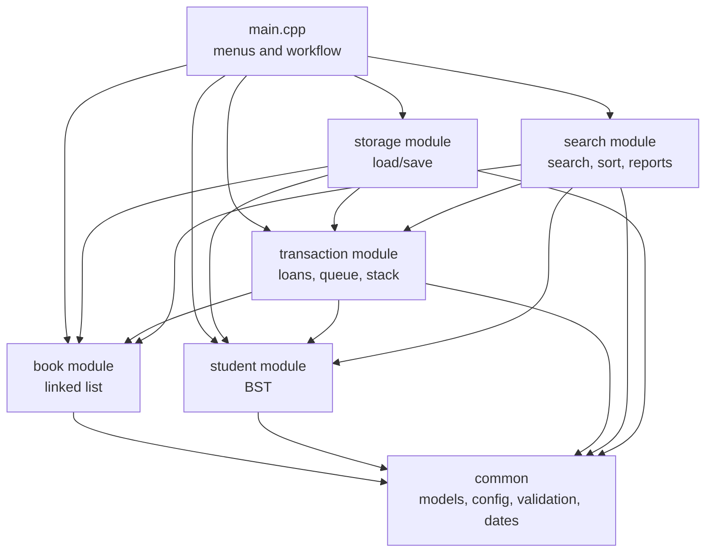

# Design Document — Smart Library Management System

## 1. Architecture



The application is a single executable. Modules communicate only through public header functions. No module reaches into another module's linked-list or tree nodes.

## 2. Shared Data Model

All records are defined once in `common/models.h`:

- `Book` — linked-list node with ID, title, author, publisher, year, total copies, available copies, and `next`.
- `Student` — BST node with ID, name, course, phone, `left`, and `right`.
- `Transaction` — loan record with transaction ID, student ID, book ID, issue/due/return dates, fine, active flag, and `next`.
- `BookInfo`, `StudentInfo`, `TransactionInfo`, `ReservationInfo`, `HistoryInfo` — read-only value copies used by search, storage, and reports.

Transactions and reservations store **IDs**, not pointers. This avoids dangling references when a book or student is removed.

## 3. Module Responsibilities

### Book module (`book/`)

- Singly linked list of books.
- Insert at head in O(1).
- Lookup, update, delete, and traversal in O(n).
- Enforces unique positive IDs, non-empty title/author, valid year, and copy-count bounds.
- `updateBook` preserves the number of issued copies: total copies cannot drop below `totalCopies - availableCopies`.
- `collectBooks` returns value copies for search/sort/storage.
- Deletion is orchestrated by `main.cpp`: blocked if the book has active loans, pending reservations, or any transaction history.

### Student module (`student/`)

- Binary search tree keyed by student ID.
- Recursive insert, search, delete, and inorder traversal.
- Delete handles leaf, one-child, and two-child nodes. The two-child case copies the inorder successor's fields and deletes the successor.
- Average O(log n); worst case O(n) for an unbalanced tree.

### Transaction module (`transaction/`)

- Chronological singly linked list of all loans, with a tail pointer for O(1) append.
- Per-book reservation queue:

```cpp
struct ReservationNode { int studentId; ReservationNode* next; };
struct BookQueue { int bookId; ReservationNode* front, *rear; int count; BookQueue* next; };
```

- Linked stack for recent activity:

```cpp
struct HistoryNode { HistoryInfo info; HistoryNode* next; };
```

- Issue, return, reserve, cancel, fine calculation, borrowing-limit checks, and reservation allocation.
- `returnBook` increments availability, then dequeues reservation candidates. Ineligible students are skipped; the first eligible student is issued the copy immediately. If nobody is eligible, the copy remains available.

### Search module (`search/`)

- `collectBooks` creates a temporary `BookInfo` array.
- Linear search by title/author uses case-insensitive substring matching.
- Binary search by ID first sorts the snapshot by ID with merge sort, then searches in O(log n).
- Merge sort is implemented manually; the live linked list is never sorted.
- Reports read counts from the book, student, and transaction modules.

### Storage module (`storage/`)

- Loads books, students, transactions, and reservations in that order.
- Validates every line; malformed lines are reported and skipped.
- Restores records with saved IDs, dates, fines, and availability.
- Active transactions must reference existing books and students. Returned transactions may reference deleted records; they are kept as history and reported as load warnings.
- Rebuilds history and reconciles availability after loading.
- Saves to `.tmp` files first, then replaces originals and keeps `.bak` backups.

### Common module (`common/`)

- `models.h` — shared records.
- `config.h` — loan period, fine, borrowing limit, history size, data directory.
- `validation.h` — trimming, case conversion, integer/double parsing, prompts, yes/no input.
- `date_utils.h` — ISO date validation, serial-day conversion, date addition, date difference, today's date.

## 4. Algorithms

### 4.1 Book linked list

```text
insert: node->next = head; head = node
lookup: walk from head until ID matches
delete: keep previous pointer, unlink node, delete it
```

Complexity: insert O(1), lookup/update/delete O(n), traversal O(n).

### 4.2 Student BST

```text
insert(root, node):
    if root is empty: return node
    if node.id < root.id: root.left = insert(root.left, node)
    else if node.id > root.id: root.right = insert(root.right, node)
    else: duplicate
    return root

delete(root, id):
    if id < root.id: delete left
    if id > root.id: delete right
    otherwise:
        no left child  -> return right child
        no right child -> return left child
        two children   -> copy inorder successor, delete successor
```

Complexity: O(h) per operation, average O(log n), worst O(n); inorder O(n).

### 4.3 Reservation queue

```text
enqueue: append node at rear; update front/rear/count
dequeue: remove front node; update front/rear/count; remove empty queue
duplicate check: walk that book's queue
```

Complexity: enqueue/dequeue O(1) after locating the book queue; duplicate check O(q).

### 4.4 History stack

```text
push: node->next = top; top = node
display top N: walk from top
```

Complexity: push O(1), display O(N). History is rebuilt at startup from transactions using a merge sort by date and transaction ID.

### 4.5 Merge sort

Top-down merge sort over a temporary `BookInfo` array:

```text
mergeSort(array, left, right):
    if left >= right: return
    middle = left + (right - left) / 2
    mergeSort(left, middle)
    mergeSort(middle + 1, right)
    merge the two halves into a temporary array
    copy back
```

Complexity: O(n log n) time, O(n) space. String keys are compared case-insensitively; ties are broken by book ID.

### 4.6 Binary search

Precondition: ascending sorted array by book ID.

```text
low = 0; high = n - 1
while low <= high:
    middle = low + (high - low) / 2
    if id == array[middle].id: return middle
    if id < array[middle].id: high = middle - 1
    else: low = middle + 1
return -1
```

Complexity: O(log n) after the O(n log n) sort.

### 4.7 Linear search

Walks the snapshot and applies case-insensitive substring matching. Complexity O(n) traversal; O(n·L) in the worst case for string comparison.

### 4.8 Date and fine calculation

Dates use the fixed `YYYY-MM-DD` format. Validation checks format, leap years, and month lengths. Date arithmetic uses serial day numbers:

```text
dueDate = issueDate + 7 days
overdueDays = max(0, daysBetween(dueDate, returnDate))
fine = overdueDays * 5.0
```

Complexity: O(1) per date operation.

### 4.9 Persistence

- Escape `\` and `|` in text fields.
- Split on unescaped pipes when loading.
- Validate IDs, dates, counts, and references.
- Reconcile availability as `totalCopies - activeLoanCount` for each book.
- Rebuild history from transactions.
- Save all `.tmp` files, then replace originals and keep `.bak` backups.

## 5. File Formats

```text
books.txt
id|title|author|publisher|year|totalCopies|availableCopies

students.txt
id|name|course|phone

transactions.txt
transactionId|studentId|bookId|issueDate|dueDate|returnDate|fine|active

reservations.txt
bookId|studentId
```

`active` is `1` or `0`. `returnDate` is empty for active loans. Reservation file order preserves FIFO order per book.

## 6. Memory Ownership

- Each module owns its nodes and frees them in `clearBooks`, `clearStudents`, and `clearTransactions`.
- Search allocates temporary arrays with `new[]` and frees them with `delete[]`.
- Storage allocates temporary snapshot arrays and frees them after writing.
- Transactions and reservations never own book/student pointers.
- `main.cpp` calls all three clear functions before exiting.

## 7. Error Handling

- Invalid input is rejected with a message and re-prompted.
- Unknown IDs, duplicate IDs, unavailable copies, borrowing limits, duplicate loans, duplicate reservations, and double returns return `false` with an error string.
- Missing data files mean an empty collection; unreadable existing files stop startup so data is not overwritten.
- Malformed records are skipped with line-number warnings.
- Historical transactions that reference deleted records are preserved with a warning.
- Save failures are reported; `.bak` files preserve the previous version.
- Warnings from loading require confirmation before saving.

## 8. Complexity Summary

| Operation | Data structure / algorithm | Complexity |
|---|---|---|
| Book lookup | Linked list | O(n) |
| Book insert at head | Linked list | O(1) |
| Book update/delete | Linked list | O(n) |
| Student search/insert/delete | Ordinary BST | O(log n) average, O(n) worst |
| Student inorder traversal | BST | O(n) |
| Reservation enqueue/dequeue | Linked queue | O(1) |
| History push | Linked stack | O(1) |
| Linear search | Array traversal | O(n) |
| Binary search | Sorted array | O(log n) |
| Merge sort | Array snapshot | O(n log n) |
| Date arithmetic | Serial day numbers | O(1) |
| Load/save | File I/O and parsing | O(n) per file |
