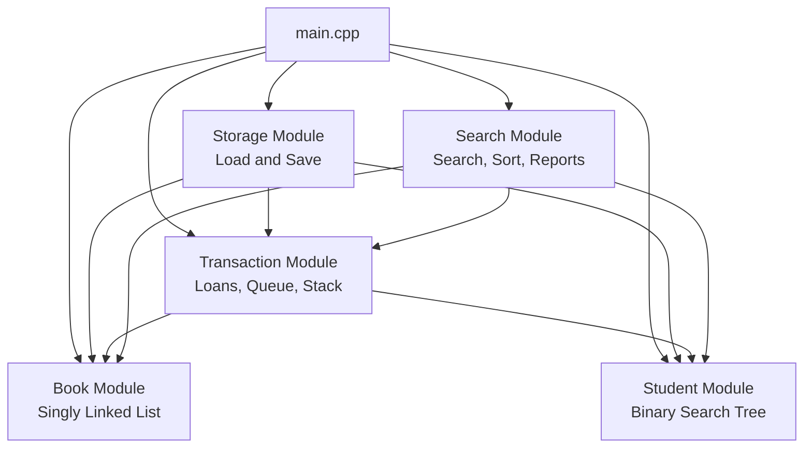
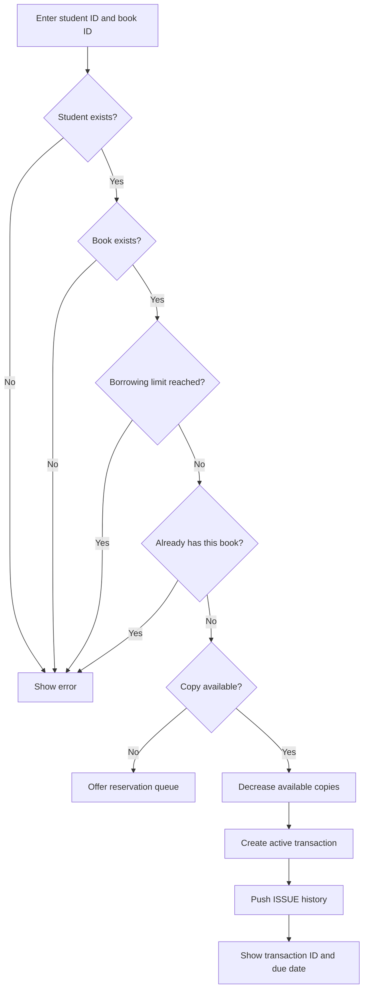
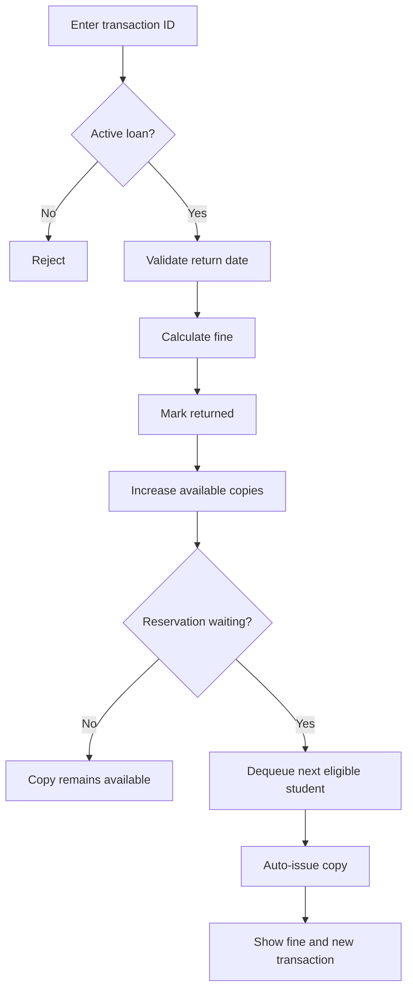
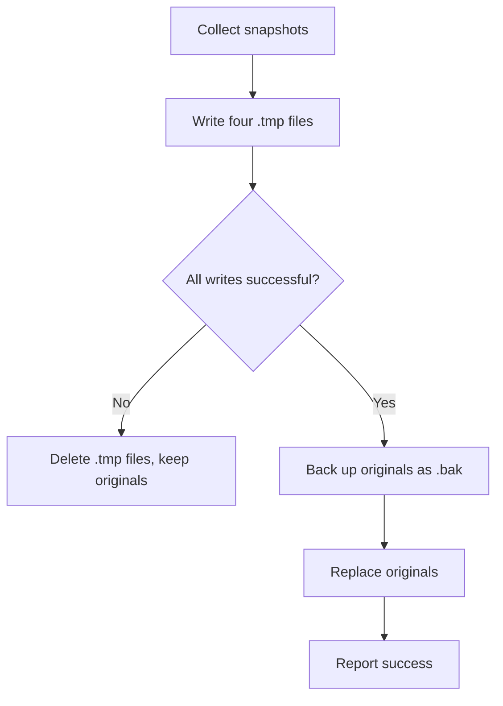

# Project Report — Smart Library Management System

## 1. Abstract

The Smart Library Management System is a console-based C++ application for managing books, students, book issuing, returns, reservations, searching, sorting, and library reports. It demonstrates the practical use of linked lists, binary search trees, queues, stacks, searching, sorting, and file persistence in one integrated application.

## 2. Objectives

- Maintain book and student records dynamically.
- Issue and return books while tracking availability.
- Calculate overdue fines automatically.
- Manage reservation waiting lists fairly using FIFO order.
- Provide fast ID-based student lookup and sorted book listings.
- Persist all records between program runs.
- Validate input and protect data integrity.
- Document the algorithms and their complexity for academic assessment.

## 3. Scope

In scope:

- Single-user console application.
- Four integrated modules: books, students, transactions, search/reports.
- Manual implementations of linked list, BST, queue, stack, merge sort, linear search, and binary search.
- Text-file persistence with load validation and backups.

Out of scope:

- Multi-user or networked access.
- Graphical interface.
- Database server.
- Online payments or real institutional fine policies.
- Automatic BST balancing.

## 4. Architecture

### Shared data

- `Book` — linked-list record.
- `Student` — BST record.
- `Transaction` — loan record.
- `Reservation` — book/student pair in a FIFO queue.
- `HistoryInfo` — activity entry in a LIFO stack.

Transactions and reservations reference books and students by ID, not by pointer, which prevents dangling references.

## 5. Workflows

### 5.1 Issue workflow

### 5.2 Return workflow

### 5.3 Save workflow

## 6. Data Structures and Algorithms

| Operation | Structure / algorithm | Complexity |
|---|---|---|
| Book lookup | Singly linked list | O(n) |
| Book insert at head | Singly linked list | O(1) |
| Book update/delete | Singly linked list | O(n) |
| Student search/insert/delete | Ordinary BST | O(log n) average, O(n) worst |
| Student inorder traversal | BST | O(n) |
| Reservation enqueue/dequeue | Linked queue with front/rear | O(1) |
| Reservation duplicate check | Queue traversal | O(q) |
| History push | Linked stack | O(1) |
| Recent history display | Stack traversal | O(N) |
| Linear search | Array traversal | O(n) |
| Binary search | Sorted array | O(log n) |
| Merge sort | Array snapshot | O(n log n) |
| Date arithmetic | Serial day numbers | O(1) |

### Why these structures?

- **Linked list for books:** dynamic size, O(1) insertion, simple manual pointer operations.
- **BST for students:** ordered records and efficient average lookup by ID.
- **Queue for reservations:** FIFO fairness.
- **Stack for history:** newest activity first.
- **Merge sort:** stable O(n log n) performance on a temporary array without sorting the live list.
- **Binary search:** correct only on an indexed sorted array, so a snapshot is created first.

## 7. Validation and Data Integrity

- Positive, unique book and student IDs.
- Non-negative copy counts and `0 <= availableCopies <= totalCopies`.
- Borrowing limit of 3 active loans.
- One active loan per student per book.
- No duplicate reservations.
- Deletion blocked for books with active loans, reservations, or transaction history; students are blocked while active loans or reservations exist.
- Double returns rejected.
- Invalid menu input and malformed file records handled without crashing.
- Availability reconciled from active loans at startup.
- Returned transactions are preserved as history even if a student is later deleted; active transactions must reference existing records.
- Missing files start empty; unreadable files stop startup.
- Save uses temporary files and `.bak` backups.

## 8. Testing

- Automated harness: **132 tests passed, 0 failed**.
- Manual end-to-end test: add book, register students, issue, reserve, return, auto-allocation, history, report, save, restart.
- Persistence verified across restart.
- Search, sort, reservation view, and save backup behavior checked manually.

See `docs/TEST_RESULTS.md` for the exact commands and results.

## 9. Limitations

- The BST is not self-balancing, so worst-case lookup is O(n).
- Book lookup by ID is O(n) because the live store is a linked list.
- The application is single-user and console-based.
- Fine policy (Rs. 5/day, 7-day loan) is an academic rule, not an institutional policy.
- History is rebuilt from transactions at startup; auto-issued loans appear as `ISSUE` after restart because the action label is not persisted separately.
- No sanitizer run was possible with the installed MinGW GCC 6.3 toolchain.

## 10. Team Contributions

| Member | Module | Main contribution |
|---|---|---|
| Member 1 | Book Management | Linked-list CRUD, copy tracking, validation |
| Member 2 | Student Management | BST insert/search/delete, inorder display |
| Member 3 | Transactions | Issue/return, fines, reservation queue, history stack |
| Member 4 | Search, Sort, Reports | Linear/binary search, merge sort, statistics |

All members share responsibility for integration, testing, documentation, and the final demonstration.

## 11. Conclusion

The system integrates the required data structures into a working library workflow rather than isolated demonstrations. It provides persistent records, validated operations, fair reservations, and documented complexity. The design keeps modules separated through headers and value snapshots, making the project maintainable and suitable for a four-member academic submission.
